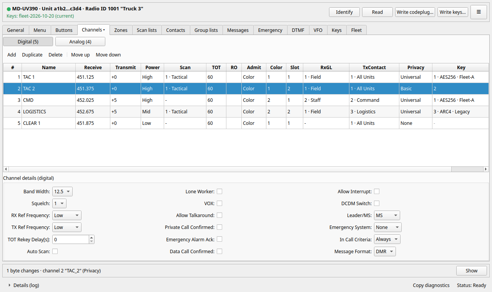
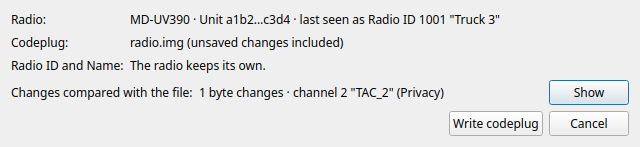
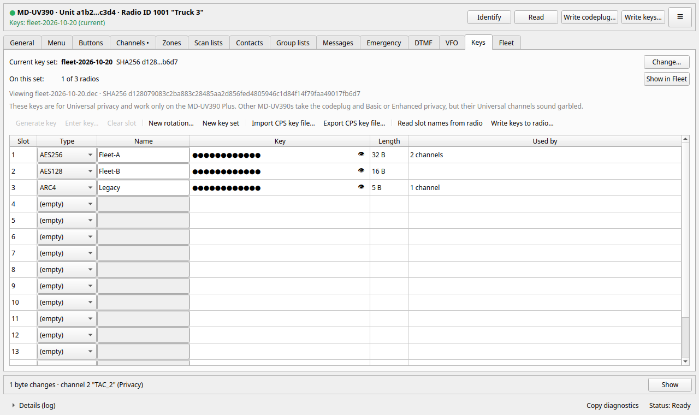
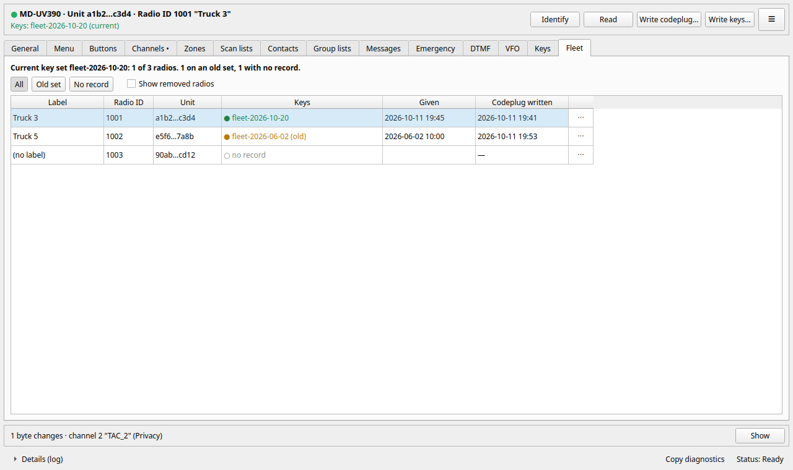

# TYTcps

A Linux programmer for the **TYT MD-UV390 Plus** family (5 W and 10 W),
**AES privacy keys included**. It does what the stock Windows CPS does
(channels, zones, scan lists, contacts, group lists, messages, and the
"Write privacy" key table), with no Windows machine in the loop.

Version 0.3 (in development). GPL-3.0-or-later.

**Documentation:** [user guide](docs/guide.md) · [FAQ](docs/faq.md) ·
[which radios](#which-radios) · [model notes](docs/models.md) ·
[for developers](docs/dev/README.md) · [changelog](CHANGELOG.md)

## Three things to know about these radios

1. **Keys cannot be read back.** The radio returns key slot types and names
   with all-zero key bytes. So TYTcps keeps a **ledger**: every key write
   records which key set (by SHA256) went to which radio, and when. It is the
   only record there is, and the Fleet tab is built on it.
2. **The key table is a fleet-wide contract, slot for slot.** A transmitting
   radio sends its key *slot number* over the air, and the receiver looks that
   number up in *its own* table. Every radio must hold the identical key set;
   the same key in a different slot will not interoperate. TYTcps writes all 16
   slots every time and warns whenever a key or type changes.
3. **Every programming session restarts the radio.** Identifying it, reading
   it and writing it all show "PC Programming Mode" and end with a restart; the
   radio is back on USB about 3 seconds later. That's why identifying the radio
   is a button and never happens by itself.

## Which radios

- **Supported, tested:** the TYT **MD-UV390 Plus**, 5 W and 10 W. It
  identifies as "MD-UV390" and has an 851968-byte codeplug. Everything in
  TYTcps was tested on these radios, keys included.
- **Should work, not tested by us:** other radios that identify as
  "MD-UV390" or "MD-UV380" with the same codeplug size. That includes the
  MD-UV390 that isn't a Plus, which can't be told apart from a Plus over
  USB. Codeplugs, and Basic and Enhanced privacy, are expected to work.
  **AES keys (Universal privacy) need the Plus:** on any other radio,
  Universal channels sound garbled, and the radio may refuse the key table
  (TYTcps then says so, and nothing is written).
- **Not supported:** anything else. TYTcps won't write a codeplug or keys
  to it, and says why.

If you have a radio in the last two groups and want to help, use ≡ →
Save diagnostics… after Identify and a Read, and send that file with a note
on the model and the firmware shown in the radio's own menu. The file never
holds keys or passwords. [docs/models.md](docs/models.md) has what is known
about the related models.

## What it does to keep a radio safe

TYTcps never opens the USB device itself. Every radio operation is one run of
its bundled engine, **dmrconfig-tyt** (in `engine/`), a fork of
[dmrconfig](https://github.com/sergev/dmrconfig) that:

- reads the radio **twice** and refuses to go on if the reads differ (a read
  can silently come back corrupt);
- reads the radio back after every codeplug write and compares it byte for
  byte, retrying a disagreeing verify read once;
- keeps the codeplug as the radio held it just before each write
  (`prewrite/` in the fleet folder, newest five per radio);
- writes the ledger line the moment the last key block is in.

Upstream `dmrconfig -c` programs a single unverified read into the radio, so
TYTcps refuses to run with any engine but the one it was built with.

On top of that, TYTcps itself:

- **edits the codeplug as text and changes only what you edited.** Every
  line you didn't touch goes to the engine exactly as it printed it;
- **previews every change** before it can be written: a dry run against the
  open file, 500 ms after you stop typing, listing each changed byte by record
  and field (`Channel 2 "TAC_2" · 0x40042 · Privacy Universal → Basic`).
  Bytes outside the rows you edited are flagged. **Write codeplug stays
  disabled until the preview has run on the exact text being written**;
- puts the engine's own error on the exact cell (`Channels row 7, Receive:
  "520.0" is outside 136-174 and 400-480 MHz`);
- tells you, after every failure, what state the radio is in: *nothing was
  written*, *the radio holds what you asked for*, or *its contents are now
  unknown, and here is how to fix that*;
- **writes only to the radio its Write dialog was opened for.** The radio
  restarts after every operation and comes back on USB about 3 seconds
  later; a different radio plugged in during that gap looks the same from
  outside. Every write names the radio it is for, and the engine refuses any
  other one before it reads, erases or sends anything.

Like the stock CPS, it never refuses to write a codeplug or keys to a radio
because of which radio it is. One codeplug file serves the whole fleet: a
write keeps each radio's own Radio ID and Name.

## Install and run

To install TYTcps as a Flatpak, see [docs/install.md](docs/install.md). To run
it from the source:

Needs Linux with Python 3.10+, PyQt6, and the engine's build dependencies:

    sudo apt install python3-pyqt6 gcc make pkg-config libusb-1.0-0-dev libudev-dev
    git clone https://github.com/Humble-Helper-96/tytcps.git && cd tytcps
    make                 # builds the bundled engine into tytcps/libexec/
    bin/tytcps           # start it
    make desktop         # optional: a launcher in your applications menu

### USB access

The radio's programming port is USB `0483:df11` (STM32 DFU). Linux needs a
udev rule to let your user open it. The first-run dialog and Settings check
for one and can install `tytcps/data/70-tytcps.rules` for you (it asks for
your password through pkexec), or run:

    sudo install -m 644 tytcps/data/70-tytcps.rules /etc/udev/rules.d/
    sudo udevadm control --reload

Then unplug and replug the radio. If the radio "is in use by another
program", a virtual machine with USB passthrough usually has it: shut the VM
down fully (pausing it is not enough).

## Using it

**First run** creates the fleet folder (`~/.local/share/tytcps`, private to
you) and offers to import a CPS key file. An imported `.dec` is kept byte for
byte, so its fingerprint stays the one radios programmed from it hold.

**Read a radio:** connect it, press **Read**. Two reads that must agree
(about 6.5 s; the radio bar shows each step and a progress bar); the result
opens as an unsaved codeplug. **Save as** to keep it.

**Change and write:** edit a cell. The strip at the bottom says what will
change; **Show** lists every byte. Then **Write codeplug…**. The radio keeps
its own Radio ID and Name (change them on the General tab only to change
them). Progress ticks through read, read, compare, erase, write, verify. The
next radio: connect it, **Identify**, **Write codeplug** again; it keeps its
own ID and Name too.

**Keys** (Keys tab): import a CPS `.dec`, generate keys (from the OS random
generator, length by type), or type them in CPS grid order. Keys are masked;
the eye shows one slot for 30 seconds. Changes are a draft that exists only
in memory until **Save as new key set**; a saved set is never edited in place.
**New rotation…** regenerates every filled slot at once.

**Write keys…** sends all 16 slots and records the ledger line. The radio
can't confirm the keys, so after every key write, check each slot you use over
the air against a radio on the same set before field use.

**Fleet** tab: every radio TYTcps has seen, which key set the ledger says it
was given, and when. During a rotation, the **Old set** filter shows the radios
still to do. **Record keys already on this radio** adds a ledger line for keys
written by the CPS (TYTcps can't check it; only do it if you know).

Advanced (≡ menu): import and export the conf text. If a codeplug write breaks
off, TYTcps offers to write the same codeplug again in full.

## Files

| What | Where |
|---|---|
| Fleet folder | `~/.local/share/tytcps/` (chosen at first run), mode 0700 |
| Key sets | `<fleet>/keys/fleet-YYYY-MM-DD.dec`, mode 0600, CPS format |
| Ledger | `<fleet>/ledger.tsv`, written by the engine only |
| Radio roster | `<fleet>/radios.tsv`; TYTcps edits only the label |
| Pre-write images | `<fleet>/prewrite/` |
| Log | `<fleet>/logs/tytcps.log`: every radio operation and any error inside TYTcps |
| Settings | `~/.config/tytcps/settings.ini` (no secrets) |
| Codeplug files | wherever you save them; no AES keys, but the older Basic/Enhanced keys in plain form, as the stock CPS's files: keep them private |

To report a problem, use ≡ → **Save diagnostics…** and send the file. It
holds versions, the USB checks, the end of the log and the open codeplug's
settings with its passwords removed. It is checked for every key in your
fleet folder before it is saved, and never contains a key file or a codeplug
image.

Everything the GUI does can also be done from a shell with the engine; see
`engine/dmrconfig-tyt/README-tyt-plus.md`.

## Development

    make test            # offline: conf round trip, engine, GUI flows offscreen
    make hooks           # pre-commit check that refuses key material

See [CONTRIBUTING](CONTRIBUTING.md) and [docs/dev](docs/dev/README.md).
The GUI flow tests drive the real windows offscreen against
`tests/fake_engine.py`, which answers like the engine but never opens USB.
The fixtures are a fictional codeplug built from `tests/fixtures/demo.conf`.

**Key material never enters this repository.** `tools/check-key-material.py`
runs as the pre-commit hook. It refuses any commit carrying the keys of the
key files it can find, in any form they have been seen in: raw or hex, file
or CPS grid order, any 8-byte fragment, any separators. It also refuses
`.dec`, `.img`, ledger, roster and capture files. Point it at key files kept
outside a fleet folder with `git config --add tytcps.keyfile '/path/*.dec'`.

The engine is a git subtree of the `tyt-plus` branch of dmrconfig-tyt.
To update it:

    git subtree pull --prefix=engine/dmrconfig-tyt <fork> tyt-plus --squash

then set `tytcps/engine_pin.json` to the new version and commit; TYTcps
refuses an engine that doesn't match its pin.

## License

Copyright (C) 2026 TYTcps contributors.

TYTcps is free software: GNU General Public License, version 3 or later
(`LICENSE`). The bundled engine in `engine/dmrconfig-tyt` is a fork of
dmrconfig by Serge Vakulenko and keeps its BSD-3 license. Other software it
uses is listed in [THIRD-PARTY.md](THIRD-PARTY.md).
